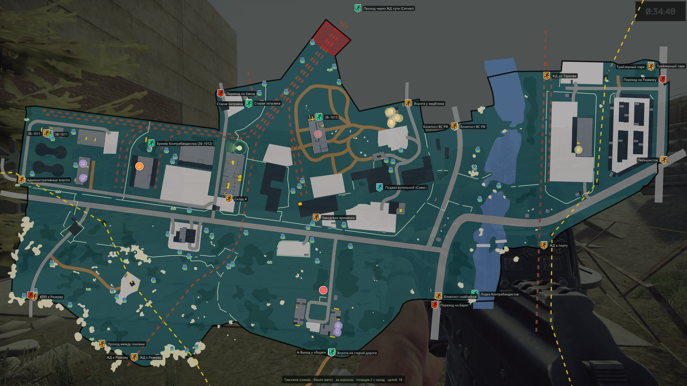
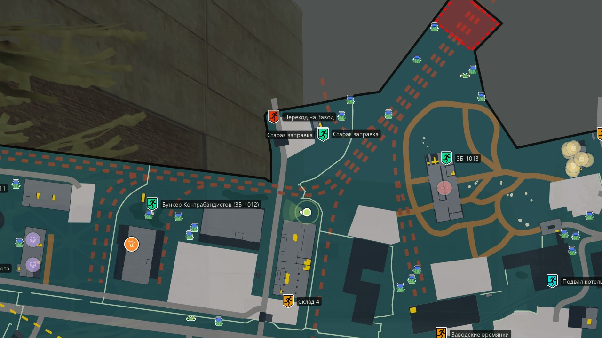

# Kartograf

[](https://github.com/thorteo/kartograf/actions/workflows/ci.yml)

A Windows overlay for Escape from Tarkov: your position and your active quest
objectives, drawn on the map on top of the game.



<details>
<summary>Close-up at full resolution</summary>



</details>

> **Status: working, pre-release.** The overlay runs in the game on its author's
> machine. There are no binary releases yet; build it from source (below). See
> [docs/features/roadmap.md](docs/features/roadmap.md) for what is done and what is next.

## How it works

The game writes its own position into the filename every time you press the screenshot
key, and logs the current map, raid state and quest progress to plain text files. This
tool reads those files and draws the result in a transparent window over the game.

**It never touches the game process** — no memory reading, no injection, no DirectX
hooking. That is a hard design constraint, not a current limitation:
[ADR 0002](docs/adr/0002-no-game-process-interaction.md).

## Features

- Your position and heading on the right map, which is picked automatically from the
  game's logs, in PvP and PvE
- Automatic floor switching on multi-level maps, from elevation and position
- Your active quests' objectives, from the game's own logs — no account linking. Each
  marker says what to do there (locate, mark, plant, pick up, kill, use); hovering it
  lists what to bring and what to hand over. A quest panel allows corrections
- Extracts by faction, transits, PMC and boss spawns, and hidden stashes, with the same
  icons as tarkov.dev
- Abstract vector maps by default, satellite tiles where no drawing exists
- See-through and click-through, with adjustable opacity; excluded from screen capture
  by default
- Russian interface by default, English with `--lang en`
- A settings window for hotkeys, map look, layers and language; after that the program
  lives in the system tray
- Idle cost near zero: a frame is drawn only when something changes

## Requirements

- Windows 10 1903 or later, x64
- Escape from Tarkov running in **borderless** or **windowed** mode — an overlay cannot
  be composited over exclusive fullscreen

## Installing

Build the Windows binary (see [Building](#building)), then

```sh
scripts/install.sh
```

copies it to `%LOCALAPPDATA%\Programs\kartograf\` and puts a shortcut on the desktop.
Running it again updates the installed copy, even while the overlay is open.

Settings, quest progress and download caches live in `%LOCALAPPDATA%\kartograf\`.

## Using it

1. Start Kartograf. The settings window opens; close it, and the overlay stays in the
   system tray (right-click for Settings and Quit).
2. Start a raid. The map is chosen from the game's logs.
3. Press the game's screenshot key whenever you want your position updated.

| Key | Action |
|---|---|
| **F5** | Show or hide the map |
| **Alt+N** | Make the overlay clickable: pan, zoom, pick a floor; shows the quest panel |
| **Alt+H** | Show or hide the detail panel (raid timer, in-game clock, position) |

All three are rebindable in settings. A bare function key is claimed globally while the
overlay runs, so F5 will not reload a browser page until it exits.

Command-line flags override the settings for one run: `--lang en|ru`,
`--toggle-key`, `--interact-key`, `--hud-key`, `--map-opacity 0..1`, `--hud`,
`--allow-capture` (let screen recorders see the overlay), `--settings` /
`--no-settings`.

## Honest limitations

- **Position updates only when you press the screenshot key.** It is a ping, not a
  continuous GPS. The map always shows how old the last fix is. Getting a live position
  would require reading game memory, which this project will not do.
- Quest progress is learnt from the logs the game keeps, about five days of them.
  Progress made before the first start and no longer in the logs is inferred from
  quest prerequisites, and can be corrected in the quest panel.

## Building

Both targets build on Linux (development happens in WSL). The portable core and UI,
with their tests:

```sh
cmake --preset linux-dev && cmake --build --preset linux-dev
ctest --preset linux-dev
```

`linux-asan` and `linux-tsan` run the same tests under AddressSanitizer and
ThreadSanitizer.

The Windows overlay is cross-compiled with clang-cl against the genuine Microsoft CRT
and Windows SDK, fetched once by [xwin](https://github.com/Jake-Shadle/xwin):

```sh
xwin --accept-license --arch x86_64 --variant desktop splat --output ~/.xwin-sdk
cmake --preset windows-dev && cmake --build --preset windows-dev
```

From WSL, `./build/windows-dev/kartograf.exe` runs it on Windows directly. Building on
Windows with MSVC also works; [docs/build.md](docs/build.md) has both routes.

CI builds all of the above on every push.

## Documentation

[docs/](docs/README.md) — architecture, decision records, and reverse-engineering notes
on the game's log and screenshot formats.

## Development

The project is developed with an AI coding agent (Claude Code) working under the rules
in [CLAUDE.md](CLAUDE.md), which is also the quickest guide to the codebase's
constraints and conventions.

## Data and credits

Quest, map, extract and spawn data come from [tarkov.dev](https://tarkov.dev)'s JSON
API, as do the map tiles and the abstract vector maps. A copy of tarkov.dev's
`maps.json` is compiled in (`data/maps.json`, MIT, © the tarkov.dev contributors).
Quest progress is read from the game's own logs.

Map marker icons are the ones tarkov.dev's interactive map uses; their repository
history records them as taken from the
[Escape from Tarkov Wiki](https://escapefromtarkov.fandom.com/), whose content is
licensed CC BY-SA. They are downloaded at runtime and cached, not distributed with this
program.

Quest objective glyphs are from [game-icons.net](https://game-icons.net) by Lorc and
Delapouite, licensed [CC BY 3.0](https://creativecommons.org/licenses/by/3.0/); see
`third_party/game-icons/`.

No game assets are bundled. Vendored code: Dear ImGui, nlohmann/json, stb_image,
lunasvg and plutovg (all MIT or public domain), doctest for tests.

Kartograf is not affiliated with or endorsed by Battlestate Games. Escape from Tarkov
is a trademark of Battlestate Games Limited.

## License

[MIT](LICENSE). Vendored code under `third_party/` keeps its own licence, as do the
quest glyphs (CC BY 3.0) and tarkov.dev's `maps.json` (MIT).
